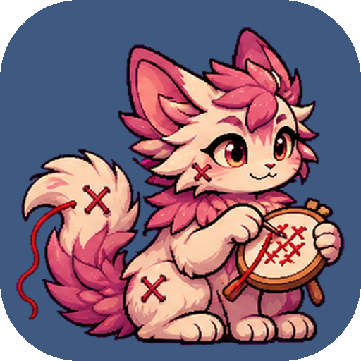
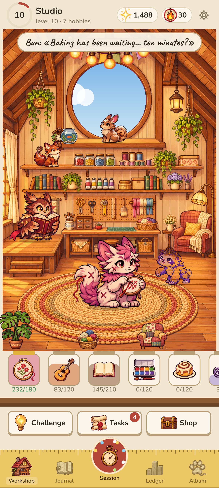
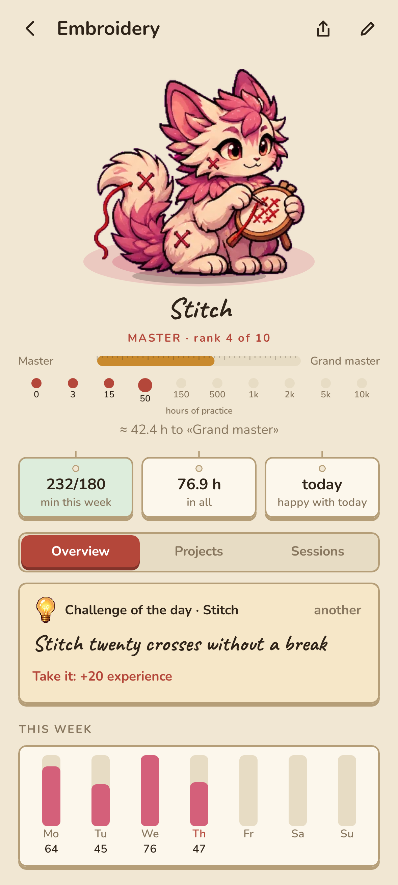
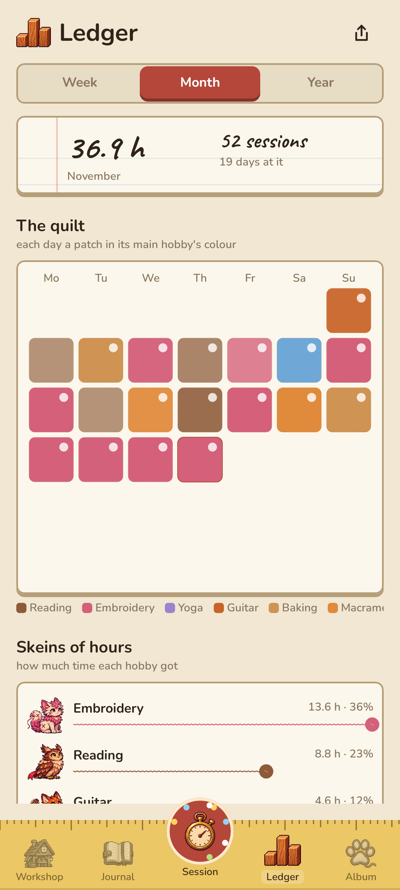

<p align="center"></p>

<h1 align="center">Knackling</h1>

<p align="center">Apprentices for your hobbies.<br>
<a href="https://bigdevwhale.github.io/stillcraft/apps/knackling/">Website</a> · <a href="https://github.com/bigdevwhale/knackling/releases/latest/download/Knackling.apk">Download APK</a> · <a href="README.ru.md">Русский</a></p>

Up in the attic of an old house there is a cosy workshop, and each of your hobbies has its own apprentice there. Embroidery gets a kitten with a hoop, guitar a fox cub with a fretboard for a tail, reading an owl with a ribbon bookmark. The apprentice hatches from an egg at your first session and grows as you practise: from hatchling to a legend that takes ten thousand hours.

<p align="center">



</p>

## Inside

- **40 hobbies and 15 free apprentices.** Music, drawing, embroidery and knitting, pottery, reading, languages, chess, gardening, fishing, dance, yoga, baking, coding, astronomy and more. Yours isn't listed? Take a free apprentice and name the hobby yourself.
- **A session in two taps.** Start the timer (it keeps going with the app closed) or log one you've done. Note how much (pages, rows, songs, kilometres), how it went, a photo of the work, a note and a project.
- **Ten ranks.** Hatchling, Pupil, Apprentice, Master and on to Legend at ten thousand hours. The high ranks wear a golden glow.
- **Challenges.** Every day the apprentice suggests a small dare: «Play your favourite song at half speed», «Draw the view from the window in one line». 160 of them.
- **Projects.** A scarf, a song, a painting, a book: mark how far along it is and hang the finished work in the showcase.
- **The ledger.** The year as a patchwork quilt, each day in the colour of the hobby you gave most time to. Hours per hobby, favourite days and times, weeks in rhythm and streaks.
- **The game.** Daily and weekly tasks with chests, sparks, a shop of things for the workshop, a shine elixir and more than eighty patches for the apron.
- **Postcards for social media.** An apprentice, a finished work, the month, the year, the workshop – as a post or a story.
- **No punishment.** Apprentices never starve or die. Leave a hobby for long and its apprentice just gets bored, then dozes off.
- **Lingvale.** The workshop joins the Lingvale village next to the other StillCraft pets.
- **Move to another phone** with one file, photos included.

## Install

Download [Knackling.apk](https://github.com/bigdevwhale/knackling/releases/latest/download/Knackling.apk) on a phone with Android 9 or newer, open it and allow installs from this source when Android asks.

## Privacy

No ads, no account, no analytics, no internet. Sessions, photos and settings stay on the phone. See [PRIVACY.md](PRIVACY.md).

## Build

JDK 17+ (Android Studio's JBR is fine) and the Android SDK.

```
git clone https://github.com/bigdevwhale/knackling.git
cd knackling
./gradlew assembleDebug
./gradlew assembleDebug -Pdemo        # app.knackling.demo: four months of sessions
```

Kotlin, Jetpack Compose, Room, DataStore. The hobby and challenge catalogue lives in `tools/hobbies.py` and `tools/ideas.py` (they generate `Catalog.kt`); growth and counting in `Engine.kt`, patches in `Badges.kt`, tasks and the shop in `Quests.kt`. The apprentices, the workshop and the things were drawn by an image model (`tools/gen_art.py`, `tools/cut.py`).

## License

MIT. Nunito and Caveat fonts (SIL OFL).

Knackling is one of the [StillCraft](https://bigdevwhale.github.io/stillcraft/) apps.
