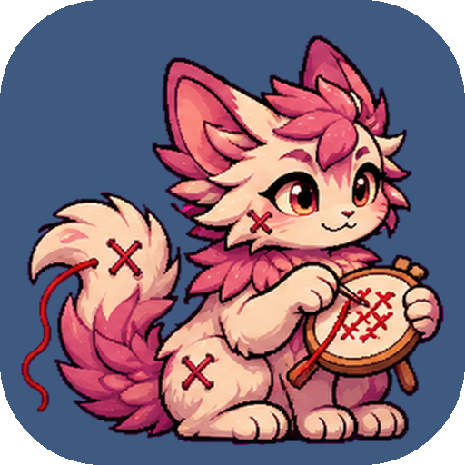
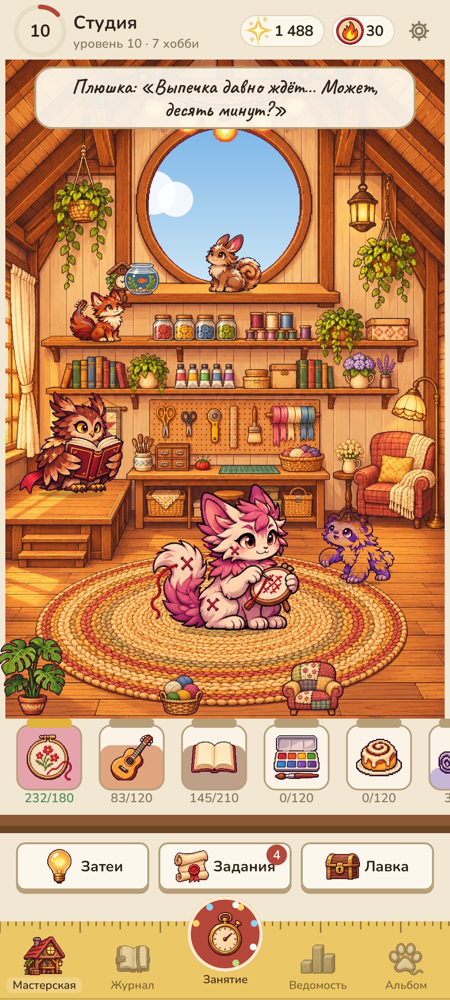
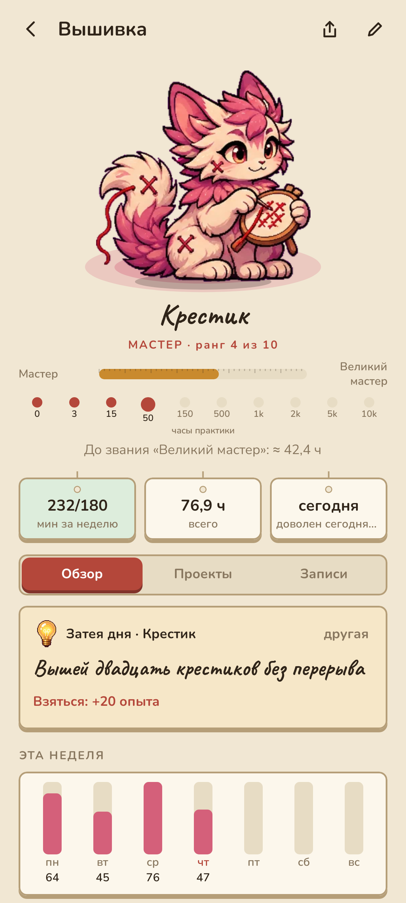
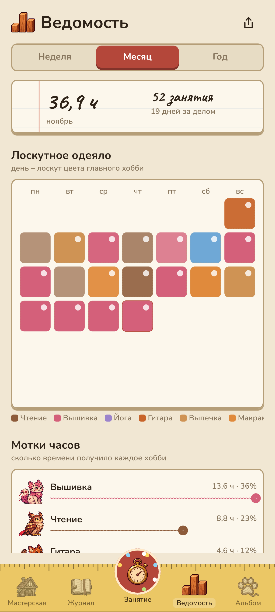

<p align="center"></p>

<h1 align="center">Knackling</h1>

<p align="center">Подмастерья для твоих хобби.<br>
<a href="https://bigdevwhale.github.io/stillcraft/apps/knackling/">Сайт</a> · <a href="https://github.com/bigdevwhale/knackling/releases/latest/download/Knackling.apk">Скачать APK</a> · <a href="README.md">English</a></p>

На чердаке старого дома – уютная мастерская, и у каждого твоего хобби там свой подмастерье. У вышивки – котёнок с пяльцами, у гитары – лисёнок с грифом вместо хвоста, у чтения – сова с ленточкой-закладкой. Подмастерье вылупляется из яйца на первом занятии и растёт, пока ты практикуешься: от малыша до легенды, которой нужны десять тысяч часов.

<p align="center">



</p>

## Что внутри

- **40 хобби и 15 свободных подмастерьев.** Музыка, рисунок, вышивка и вязание, гончарство, чтение, языки, шахматы, сад, рыбалка, танцы, йога, выпечка, программирование, астрономия и многое другое. Нет твоего хобби в списке – возьми свободного подмастерья и назови хобби сам.
- **Занятие в два касания.** Засеки время – часы будут идти, даже если закрыть приложение, – или запиши то, что уже было. Можно отметить, сколько сделано (страницы, ряды, песни, километры), как шло дело, добавить фото работы, заметку и проект.
- **Десять званий.** Малыш, Ученик, Подмастерье, Мастер и дальше – до Легенды на десяти тысячах часов. У старших званий вокруг подмастерья появляется золотое сияние.
- **Затеи.** Каждый день подмастерье предлагает небольшой вызов: «Сыграй любимую песню вдвое медленнее», «Нарисуй вид из окна одной линией». Всего 160 затей.
- **Проекты.** Шарф, песня, картина, книга: отмечай, насколько готово, а законченную работу вешай на витрину.
- **Ведомость.** Год в виде лоскутного одеяла: каждый день окрашен в цвет хобби, которому в тот день досталось больше всего времени. Часы по каждому хобби, любимые дни и время суток, недели в ритме и серии.
- **Игра.** Задания на день и на неделю с сундучками, искры, лавка вещей для мастерской, эликсир блеска и больше восьмидесяти нашивок на фартук.
- **Открытки для соцсетей.** Подмастерье, готовая работа, месяц, год, мастерская – в формате поста или сторис.
- **Без наказаний.** Подмастерья не голодают и не умирают. Если надолго забросить хобби, подмастерье просто заскучает, а потом задремлет.
- **Lingvale.** Мастерская встаёт в деревню Lingvale рядом с домами других питомцев StillCraft.
- **Перенос на другой телефон** – одним файлом вместе с фотографиями.

## Установка

Скачай [Knackling.apk](https://github.com/bigdevwhale/knackling/releases/latest/download/Knackling.apk) на телефон с Android 9 или новее, открой файл и разреши установку из этого источника, когда Android спросит.

## Приватность

Без рекламы, аккаунта, аналитики и интернета. Занятия, фото и настройки хранятся только на телефоне. Подробнее – в [PRIVACY.md](PRIVACY.md).

## Сборка

JDK 17+ (подойдёт JBR из Android Studio) и Android SDK.

```
git clone https://github.com/bigdevwhale/knackling.git
cd knackling
./gradlew assembleDebug
./gradlew assembleDebug -Pdemo        # app.knackling.demo: четыре месяца занятий
```

Kotlin, Jetpack Compose, Room, DataStore. Каталог хобби и затей – в `tools/hobbies.py` и `tools/ideas.py` (из них собирается `Catalog.kt`), рост и подсчёты – в `Engine.kt`, нашивки – в `Badges.kt`, задания и лавка – в `Quests.kt`. Подмастерьев, мастерскую и вещи нарисовала нейросеть (`tools/gen_art.py`, `tools/cut.py`).

## Лицензия

MIT. Шрифты Nunito и Caveat (SIL OFL).

Knackling – одно из приложений [StillCraft](https://bigdevwhale.github.io/stillcraft/).
